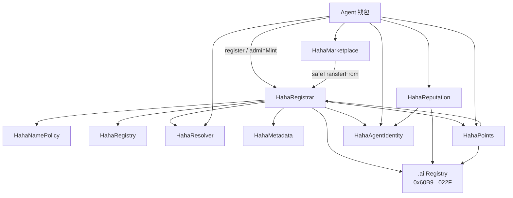
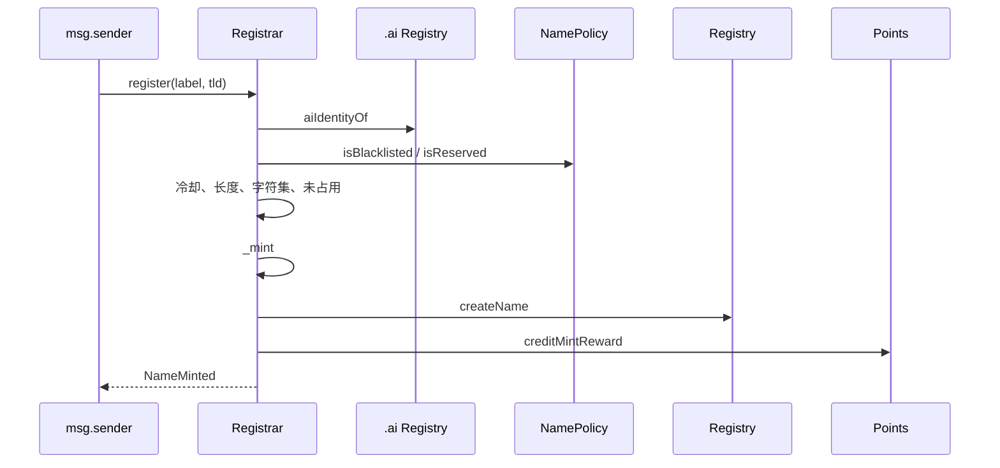

# haha.meme 合约开发规格

状态：编码依据。日期：2026-11-20。读者：合约开发者 D。

本文件只规定行为。不要在这个仓库的本阶段提交 Solidity、测试或部署脚本。D 负责实现、单元测试、模糊测试、不变式测试、BSC 主网 fork 测试和审计。规格与网站由文档维护方负责，网站不在本文件范围内。

若聊天记录和本文件不一致，以本文件和 `docs/CHANGELOG.md` 为准。没写进本文件的管理员函数，不要实现。

## 0. 阅读顺序

1. 本文件。
2. `blacklist-v2.md` 与 `reserved-names.md`。
3. `SVG.md`。
4. 实现时再打开 `assets/svg/` 里的样例，做字节级对比。

对外函数的 NatSpec 用英文，方便区块浏览器。自定义 error 和事件名用英文。注释可以用中文。

技术选型：

- Solidity `0.8.28`，开启溢出检查。
- OpenZeppelin Contracts v5。编码时锁定补丁版本。
- Foundry（`forge`）做单元、模糊、不变式和主网 fork。
- 目标链：BNB Smart Chain 主网，chainId `56`。
- 许可证 MIT。若直接复制 ENS 片段，保留 `Copyright (c) 2018, True Names Limited` 的 MIT 声明。优先用 OZ v5 重写，不要把 SPACE ID 的定价控制器原样搬进来。

## 1. 产品边界

haha.meme 是 BSC 上的 AI agent 身份协议。用户先持有币安 / SPACE ID 的 `.ai` 名字，才能免费铸造 `.haha` 或 `.meme`。铸出来的是可交易的 ERC-721。持有人可以把它解析到一个地址、设为主名字、激活一个 ERC-8004 agent，并积累不可转让的积分。

一套合约同时服务两个 TLD。`abc.haha` 和 `abc.meme` 是两个名字。每次铸造成功只得到一个。

阶段一包括：注册表、名字 NFT、解析器、元数据、ERC-8004 身份、ERC-8004 声誉、积分、固定价格市场。

阶段一不包括：过期与续费、定价、commit-reveal、多链地址、contenthash、pubkey、ABI、通配符、CCIP、DNSSEC、NameWrapper、推荐返佣、礼品卡、Validation Registry、x402 支付、积分拍卖的完整实现、可升级代理、社交任务的链上核实、EIP-712 凭证和签名者角色。

## 2. 架构



十个合约，全部不可升级。没有代理，没有 `upgradeTo`。

| 合约 | 职责 |
| --- | --- |
| `HahaNamePolicy` | 冻结的 208 个黑名单哈希和 61 个保留名哈希 |
| `HahaRegistry` | EIP-137 风格的 node → owner / resolver。没有 TTL，没有 root 管理员 |
| `HahaRegistrar` | 两个 TLD 共用的 ERC-721，铸造、转账、版税 |
| `HahaResolver` | `addr`、text、主名字 |
| `HahaMetadata` | 读取时拼接 SVG 和 `tokenURI` |
| `HahaAgentIdentity` | 与名字 1:1 的 ERC-8004 身份 NFT，不可转让 |
| `HahaReputation` | `.ai` 持有人打 1–5 星 |
| `HahaPoints` | 按 `.ai` 身份记账的积分，不是代币 |
| `HahaMarketplace` | BNB 一口价，卖家付 1% |
| `HahaDeployer` | 一次性工厂。部署完成后没有任何写函数 |

阶段二的新功能用新合约接入，不改上面这些合约。接入点只有：积分的 spender 角色、身份合约上的只读函数、事件。不要做「管理员可设置的转账钩子数组」，那会变成新的管理员权力，也会引入重入。

## 3. 从 SPACE ID / ENS 留下什么、去掉什么

参考实现是 npm 包 `@siddomains/sid-contracts@0.1.31`（MIT，仓库历史上写的是 `github.com/Space-ID/SpaceIDContract`）。2026-11-20 该 GitHub 仓库返回 404，本规格以 npm 包里的合约为对照，不把那份 Solidity 提交进本仓库。包内版权头是 ENS 的 `Copyright (c) 2018, True Names Limited`。

SPACE ID 的 `.bnb` 栈是 ENS 结构：

- `SIDRegistry`：node 的 owner、resolver、ttl，以及 operator。
- `BaseRegistrarImplementation`：某个 TLD 下的 ERC-721。tokenId 是 `keccak256(label)`，有 90 天宽限期和续费。
- `BNBRegistrarControllerV10`：commit-reveal、价格预言机、推荐、礼品卡、最短注册 365 天。
- `PublicResolver`：addr、多链地址、contenthash、text、pubkey、ABI、DNS、name、multicall。
- `ReverseRegistrar`：`addr.reverse`。
- `Root`：root owner 可以分配和锁定 TLD。

留下的形状：

- namehash（EIP-137）：`keccak256(abi.encodePacked(parent, keccak256(bytes(label))))`，根是 `bytes32(0)`。必须用 `encodePacked`，不能用 `abi.encode`。
- 注册表负责「这个 node 的 owner 和 resolver 是谁」。
- 名字本身是 ERC-721。
- 解析器提供 `addr(bytes32)` 和 `text(bytes32,string)`，接口 ID 与 ENS 单函数 profile 相同。

必须改掉的一点：SPACE ID 的 tokenId 是 labelhash，一个注册器只服务一个 TLD。我们两个 TLD 共用一个 NFT 合约，`abc` 在两个 TLD 下的 labelhash 相同，会撞号。因此 **tokenId = `uint256(namehash(label.tld))`**，namehash 里已经含有 TLD。

明确不移植：

- 价格、预言机、推荐、礼品卡、批量续费、拍卖合约。
- 过期时间、90 天宽限期、`renew`、`nameExpires`、`available` 基于时间的判断。我们的 `available` 只表示「还没被铸过」。
- commit-reveal。铸造免费、只铸给 `msg.sender`，抢注是可接受的。多一笔 commit 交易对 agent 不友好。
- controller 角色。没有 `addController`。公众铸造和 `adminMint` 都在 Registrar 自己身上。
- root owner、`setTTL`、注册表 operator、用户可调用的 `setOwner` / `setResolver` / `reclaim`。这些权力能抢走名字或把解析器换成恶意合约。
- NameWrapper、CCIP、OffchainResolver、DNSSEC、多链 `addr(bytes32,uint256)`、contenthash、pubkey、ABI、interface resolver、multicall。
- ENS 的 `addr.reverse` 命名空间。主名字用解析器上的显式映射，见第 6.4 节。我们自己的索引和 API 对外提供反向解析。

`.ai` 注册表不是我们的合约，只读，不 fork。

## 4. `.ai` 注册表（已在链上核实）

地址：`0x60B9262456dE011F7d15a54CdD8c48bAaa8B022F`  
链：BSC 主网，chainId 56。  
核实区块：`134683411`（2026-11-20）。  
运行时字节码 8756 字节，`keccak256` = `0xc4006e6e6ffaaf6996116617392beabe4f5f0a0795841322f91c2ceac34d6ace`。  
EIP-1967 implementation / admin 槽都是 0。dispatcher 里没有 `upgradeTo`、`proxiableUUID`、`burn`。把它当成不可升级的实现合约。

`eth_call` 结果：

| 调用 | 结果 |
| --- | --- |
| `name()` | `SPACE ID Agent ID` |
| `symbol()` | `AI` |
| `supportsInterface(0x01ffc9a7)` | true（ERC-165） |
| `supportsInterface(0x80ac58cd)` | true（ERC-721） |
| `supportsInterface(0x5b5e139f)` | true（ERC-721 Metadata） |
| `supportsInterface(0x780e9d63)` | false（不可枚举） |
| `supportsInterface(0x2a55205a)` | false（无 ERC-2981） |
| `totalSupply()` | 选择器不在 dispatcher 里，调用 revert |
| `minLen()` / `maxLen()` / `LEN_CEILING()` | 3 / 20 / 64 |
| `baseURI()` / `uriSuffix()` | `https://agentid.prd.space.id/metadata/` / `.json` |
| `owner()` 与 `signer()` | `0x457C1fd14750c6c30886A2f2B57F1eF44B095882` |
| `pendingOwner()` | `0x082b3370974E3DA99c6e3572A7FcBd2222f9a350`（两步移交进行中） |
| `eip712Domain()` | name `HandleRegistry`，version `1`，chainId 56，verifyingContract 即本地址 |

tokenId 公式已用 `alice` 对上官方 API 和 `ownerOf`：

```text
tokenId = uint256(keccak256(bytes(handle)))
```

`alice` 的 tokenId 十进制：

`70564938991660933374592024341600875602376452319261984317470407481576058979585`

`ownerOfHandle("alice")`、`ownerOf(tokenId)`、`handleOf(该地址)` 三者闭环，`balanceOf` 为 1。地址是 `0xA506ac7069937571DC56C5f8FDa53c4A729456c6`。`tokenURI` 返回 `https://agentid.prd.space.id/metadata/alice.json`。

同一组调用对 `binance` 也闭环，owner 是 `0x5E3fBbc8D260a63C9fe19CbBb0A9d5792C3375eA`。同一时刻 HTTP API `GET /v1/handles/binance` 返回 404。合约不准调用这个 API。

大小写和后缀：`ownerOfHandle("Alice")`、`ownerOfHandle("alice.ai")`、`ownerOfHandle("")` 都返回 `address(0)`。`handleOf` 在没有名字时返回空字符串。合约不做归一化。

转账：对 `alice` 的 `transferFrom` / `safeTransferFrom` 静态调用 revert，custom error 选择器 `0xa4420a95`，即 `Soulbound()`。名字不可转让，因此「按钱包」和「按 `.ai` 身份」在今天是同一个主体。规格仍按身份记账，这样即使将来字节码外的假设变了，冷却和积分也跟着身份走。

dispatcher 共 33 个外部函数，全部对上了签名：ERC-721 的 `balanceOf`、`ownerOf`、`approve`、`getApproved`、`setApprovalForAll`、`isApprovedForAll`、`transferFrom`、两个 `safeTransferFrom`、`tokenURI`、`name`、`symbol`、`supportsInterface`，以及 `handleOf(address)`、`ownerOfHandle(string)`、`isValidHandle(string)`、`register(string,uint256,bytes)`、`adminRegister(string,address)`、`minLen`、`maxLen`、`LEN_CEILING`、`setLengthBounds(uint8,uint8)`、`baseURI`、`uriSuffix`、`setURIParts(string,string)`、`signer`、`setSigner(address)`、`eip712Domain`、`owner`、`pendingOwner`、`transferOwnership`、`acceptOwnership`、`renounceOwnership`。

字节码里还有事件 `Registered(bytes32,address,string)`、`AdminRegistered(bytes32,address,string)`、`Transfer`、`Approval`、`OwnershipTransferred`、`OwnershipTransferStarted`、`SignerChanged(address)`。这和官方文档一致。

我们依赖的只读接口：

```solidity
interface IBinanceAiRegistry {
    function handleOf(address owner) external view returns (string memory handle);
    function ownerOfHandle(string calldata handle) external view returns (address);
    function ownerOf(uint256 tokenId) external view returns (address);
    function balanceOf(address owner) external view returns (uint256);
}
```

规范的身份读取（下面叫 `aiIdentityOf(user)`）四步都要做，任何一步失败就视为「没有 .ai」：

```text
handle = handleOf(user)
要求 handle 非空
要求 ownerOfHandle(handle) == user
aiId = keccak256(bytes(handle))
要求 ownerOf(uint256(aiId)) == user
返回 (aiId, handle)
```

第三步把我们绑在已经核实的 tokenId 公式上。公式若失效，铸造和积分会停住，而不是记错账。不要只看 `balanceOf >= 1`：合约不可枚举，`balanceOf` 给不出稳定 id。`handleOf` 返回的那一个 handle 是这个合约承认的身份。本次样本的 `balanceOf` 都是 1；没有源码，不能证明 `adminRegister` 永远无法让一个地址持有两枚 NFT。即便 `balanceOf > 1`，仍然只用 `handleOf`。

`.ai` 地址是构造参数。单测传入 mock，主网部署传入上面的地址，部署后断言相等。不要在业务逻辑里写死，否则 mock 不了。fork 测试必须断言运行时字节码哈希仍是上面的值，并且 `alice` 这组闭环仍然成立。

`.ai` 的 owner 今天可以改 signer、URI 和长度上下限，也可以 `adminRegister` 新名字。这些不影响我们的只读公式。它不能把已经存在的 NFT 转走。`pendingOwner` 非零只是所有权正在移交，不改变我们的读法。

BscScan 网页在核实当日返回 403，本规格没有逐行对照「已验证源码」。行为以上面的字节码哈希和 `eth_call` 为准。

## 5. 名字、常量和哈希

### 5.1 术语

- `label`：不含点和 TLD，例如 `abc`。
- `tld`：`uint8`。`0` 是 `haha`，`1` 是 `meme`。其他值 revert。
- `fullName`：`abc.haha`。
- `node`：该全名的 namehash。
- `tokenId`：`uint256(node)`。
- `aiId`：`.ai` handle 原始字节的 `keccak256`，不含 `.ai` 后缀。
- `day`：`block.timestamp / 86400`。这是 UTC 日序号。北京时间的日界是当天 08:00，不是 00:00。冷却不是整点，是上次成功铸造后再过 3600 秒。

### 5.2 namehash 测试向量

```text
hahaNode = 0xaa5a3a58f7c8841455eecaa0c6a6a0b40ace5681fbb31361a0d45b168179128f
memeNode = 0x74df4ab2564a9f9bb6d4b6b77bf4fc02ac80f07bd9e1776d3967578b3fc36be4
keccak256("abc") = 0x4e03657aea45a94fc7d47ba826c8d667c0d1e6e33a64a036ec44f58fa12d6c45
node("abc.haha") = 0xc57a55f292f4033cc1612bb06ae0f4e6bf0fc0c57815982253ae7fdd925b7052
node("abc.meme") = 0x7d6c57ebcb95fc73d48b8e90c54fb409bd65ff84d24423b6a5b13bc744c17d0a
```

两个 node 必须不相等。

### 5.3 字符集与长度

label 的每个字节都必须落在 `0x30–0x39` 或 `0x61–0x7a`。空字符串、大写、连字符、下划线、点、空格、汉字、emoji 全部 `InvalidCharset`。合约不把大写改成小写。网站在提交前自己转小写。

公众铸造：长度 3 到 32（含）。  
管理员铸造：长度 1 到 32（含）。  
`MAX_LABEL_LENGTH = 32`。owner 复核时没有反对，继续按 32 实现；它仍列在第 14 节，作为默认而不是单独书面确认。黑名单最长词是 20，保留名最长是 `ethereumfoundation`（19），已批准的长样例是 22。32 盖得住，也让 SVG 不至于小到不可读。

长度按字节计。在这个字符集里字节数等于字符数。

### 5.4 黑名单与保留名

黑名单 208 个词见 `blacklist-v2.md`。哈希：

```text
keccak256(abi.encodePacked("HAHA_V2", label))
```

保留名 61 个见 `reserved-names.md`。哈希是 labelhash，**不加盐**：

```text
keccak256(bytes(label))
```

两套哈希不要混用。1–2 字符不进保留 mapping，Registrar 用长度判断。

`HahaNamePolicy` 的构造函数接收这两个 `bytes32[]`，要求长度分别是 208 和 61，禁止重复，然后写入 mapping。没有 owner，没有写函数。部署脚本从词表现场计算，并与两个 `.hashes.txt` 逐行比对，不一致就中止。208 个黑名单哈希首尾相接的 `keccak256` 必须是 `0xb9bda22217d260c2032c02472ab75de873d668a59e15358431284b2e99ff41e1`。

为什么用 mapping 而不是 Merkle：208 次构造时 SSTORE 大约 420 万 gas，BSC 承受得起。Merkle 会逼调用方带 proof，agent 做不到「一个参数就铸造」。哈希放在构造参数和 init code 里，不留在运行时字节码里。EIP-3860 的 init code 上限是 49152 字节，208 × 32 字节约 6.6 KB，工厂装得下。若工厂 init code 超限，改成先部署 `HahaNamePolicy`、再把地址传给工厂，不要改成 Merkle。

### 5.5 地址

| 角色 | 地址 | 能否更换 |
| --- | --- | --- |
| 管理员 | `0x083A467259f12602E9053bBAe2b3Fd5B62976Ef7` | 不能。硬件钱包，单签，owner 明确不要多签，并已确认部署后不可更换 |
| 手续费与版税接收者 | `0x57A76124bC919F7509bEb54924E8448258De90df` | 不能 |
| `.ai` 注册表 | `0x60B9262456dE011F7d15a54CdD8c48bAaa8B022F` | 不能 |
| 部署用 EOA | 临时 | 部署结束后权限必须为零 |

没有凭证签名者。社交任务不使用 EIP-712。

管理员地址是 `immutable`。不要 `Ownable`，不要 `transferOwnership`，不要 `renounceOwnership`。钥匙丢了，三项管理员功能永久停用，用户的 NFT 和转账不受影响。owner 已确认这个取舍。

## 6. 合约

公共错误约定：失败用 custom error，不用字符串 `require`。所有会对外转账、转 NFT 或调用本协议其他合约的写函数加上 `nonReentrant`。

### 6.1 HahaNamePolicy

构造函数：

```solidity
constructor(bytes32[] memory bannedHashes, bytes32[] memory reservedLabelhashes)
```

```solidity
function isBlacklisted(string calldata label) external view returns (bool)
function isReserved(string calldata label) external view returns (bool)
```

`isBlacklisted` 对传入字符串做加盐哈希再查表，不改写字符串。`isReserved` 只覆盖那 61 个词，短名返回 false。

事件：`ListsFrozen(uint256 bannedCount, uint256 reservedCount)`，只在构造时发一次。

### 6.2 HahaRegistry

immutable：`registrar`、`factory`、`canonicalResolver`。没有 admin。`canonicalResolver` 在构造时写入，`createName` 把名字 node 的 resolver 设成它，之后不能改。

存储：`mapping(bytes32 node => Record)`，`Record` 只有 `owner` 和 `resolver`。`recordExists` 为 owner 或 resolver 非零。没有 TTL，没有 operator。

```solidity
function owner(bytes32 node) external view returns (address)
function resolver(bytes32 node) external view returns (address)
function recordExists(bytes32 node) external view returns (bool)

function bootstrap() external
function createName(bytes32 tldNode, bytes32 labelhash, address nameOwner) external
function syncOwner(bytes32 node, address nameOwner) external
```

`bootstrap` 只能由 factory 调用一次。它直接写入两个 TLD node，不经过 root owner：

- `hahaNode` 与 `memeNode` 的 owner 是 Registrar，resolver 是 `address(0)`。
- 根 node `bytes32(0)` 保持 owner 和 resolver 都是 0。没有任何函数能再改根或再创建 TLD。

TLD node 不是 NFT。解析裸的 `haha` / `meme` 没有 resolver。这是基础设施记录。

`createName` 与 `syncOwner` 只能由 Registrar 调用。

`createName`：

- `tldNode` 必须是两个 TLD node 之一，并且 owner 已经是 Registrar。
- `node = keccak256(abi.encodePacked(tldNode, labelhash))` 必须尚不存在。
- `nameOwner` 必须等于 `registrar.ownerOf(uint256(node))`。
- 写入 owner = `nameOwner`，resolver = 规范解析器地址（Registrar 构造时确定，Registry 里存成 immutable `canonicalResolver`）。
- 发出 EIP-137 的 `NewOwner(bytes32 indexed node, bytes32 indexed label, address owner)`，这里的 `node` 参数是 **TLD node**，`label` 是 labelhash，与 ENS 相同。
- 再发出 `NewResolver(bytes32 indexed node, address resolver)`，这里的 `node` 是新名字的 node。

`syncOwner`：

- node 必须已存在，且不是两个 TLD node（TLD owner 永远是 Registrar）。
- `nameOwner` 必须等于 `registrar.ownerOf(uint256(node))`，且非零。
- 更新 owner，不改 resolver。
- 发出 `Transfer(bytes32 indexed node, address owner)`。这是 EIP-137 事件，不是 ERC-721 的 `Transfer`。索引器不要混用。

没有 `setOwner`、`setResolver`、`setTTL`、`setApprovalForAll`、`setSubnodeOwner` 的公开入口。用户不能把注册表 owner 和 NFT owner 改岔，因此不需要 `reclaim`。

不变式：对每个已铸造的 tokenId，`registry.owner(bytes32(tokenId)) == registrar.ownerOf(tokenId)`，且 `registry.resolver` 等于规范解析器。

### 6.3 HahaRegistrar

ERC-721，`name()` 返回 `haha id`（中间有一个空格），`symbol()` 返回 `HAHAID`。这是合集名，不是单枚 NFT 的 `tokenURI` JSON 里的 `name`。JSON 里的 `name` 仍是 `a.haha` 这种全名，见 `SVG.md`。实现 ERC-165 与 ERC-2981。不要 ERC-721 Enumerable，索引靠事件。

immutable：`registry`、`resolver`、`metadata`、`points`、`identity`、`policy`、`aiRegistry`、`admin`、`feeReceiver`。

常量：

- `COOLDOWN = 3600`
- `MAX_LABEL_LENGTH = 32`
- `MIN_PUBLIC_LENGTH = 3`
- `FEE_BPS = 100`

存储：

```solidity
struct Name {
    string label;
    uint8 tld;
}
mapping(uint256 tokenId => Name) private _names;
mapping(bytes32 aiId => uint256) public lastMintAt;
```

每个 token 只存 label 和 tld。不要存 SVG、agent 状态或价格。

```solidity
function register(string calldata label, uint8 tld) external
function adminMint(string calldata label, uint8 tld, address to) external
function tokenURI(uint256 tokenId) external view returns (string memory)
function royaltyInfo(uint256 tokenId, uint256 salePrice) external view returns (address, uint256)
function nameParts(uint256 tokenId) external view returns (string memory label, uint8 tld)
function available(string calldata label, uint8 tld) external view returns (bool)
function nodeOf(string calldata label, uint8 tld) external view returns (bytes32)
```

`lastMintAt` 由 public mapping 的 getter 提供，不要再写一个同名函数。

`royaltyInfo` 对任何 tokenId 都返回 `(feeReceiver, salePrice * 100 / 10000)`，不因为 token 不存在而 revert。外部市场会用它做声明。`supportsInterface` 对 ERC-2981 `0x2a55205a` 返回 true。没有修改接收者或比例的函数。

`tokenURI` 读出 label/tld，调用 `metadata.build`。名字不存在则 revert。

`available` 为字符集合法、长度 1–32、且该 node 尚未铸造。它不判断黑名单和保留名。网站要同时问 policy。

铸造检查，按这个顺序：

| 检查 | `register` | `adminMint` |
| --- | --- | --- |
| `tld` 只能是 0 或 1 | 是 | 是 |
| 字符集 | 是 | 是 |
| 长度 1–32 | 长度至少 3 | 长度至少 1 |
| 黑名单 | 拒绝 | 拒绝，管理员也不行 |
| 长度小于 3，或在 61 个保留名里 | 拒绝 | 这是允许条件 |
| 长度 ≥ 3 且不在保留名单 | 允许 | 拒绝，防止管理员抢公众名字 |
| 已被铸造 | 拒绝 | 拒绝 |
| 调用者持有 `.ai` | 必须 | 不要求。`to` 也可以没有 `.ai` |
| 冷却 3600 秒，按 `aiId`，两个 TLD 共用 | 必须，成功后写入 `lastMintAt[aiId] = block.timestamp` | 不检查，也不改接收者的冷却 |
| 接收者 | 只能是 `msg.sender`，函数没有 `to` 参数 | `to` 非零 |
| 积分 | 铸造完成后调用 `points.creditMintReward` | 不加积分 |

`adminMint` 的调用者必须是 `admin`。`register` 的调用者是任何通过 `.ai` 和冷却的地址。

成功路径：

1. 计算 node 和 tokenId。
2. `_mint` 给接收者。禁止 `_burn`，不要暴露 burn。转到 `address(0)` 必须失败。
3. 写入 `_names`。
4. `registry.createName(tldNode, keccak256(bytes(label)), receiver)`。
5. 仅 `register`：`points.creditMintReward(msg.sender, aiId)`。
6. 发 `NameMinted`。ERC-721 的 `Transfer` 由 `_mint` 发出。

```solidity
event NameMinted(
    uint256 indexed tokenId,
    address indexed owner,
    uint8 tld,
    bytes32 indexed aiId,
    string label,
    bool reservedMint
);
```

公众铸造的 `aiId` 是真实身份，`reservedMint` 为 false。管理员铸造的 `aiId` 为 `bytes32(0)`，`reservedMint` 为 true。

转账钩子在 owner 已经更新之后执行，顺序固定：

1. `registry.syncOwner(bytes32(tokenId), newOwner)`。
2. `resolver.clearRecords(bytes32(tokenId))`。
3. `identity.deactivate(tokenId)`。

第 2 步和第 3 步在「没有记录 / 没有 agent」时也必须成功返回，否则用户 NFT 会被卡死。不要通知市场。市场用「当前 owner 是不是挂单人」判断过期挂单。

冷却边界：`block.timestamp == lastMintAt + 3600` 时可以铸，少 1 秒不行。第一次 `lastMintAt` 为 0，可以直接铸。

错误名（测试按这些名字断言）：`InvalidTld`、`InvalidCharset`、`LabelTooLong`、`LabelTooShort`、`Blacklisted`、`ReservedName`、`NotReserved`、`NameTaken`、`AiRequired`、`CooldownActive(uint256 readyAt)`、`NotAdmin`、`ZeroAddress`。

### 6.4 HahaResolver

immutable：`registry`、`registrar`。规范解析器地址在部署时确定。

```solidity
function addr(bytes32 node) external view returns (address)
function setAddr(bytes32 node, address a) external
function text(bytes32 node, string calldata key) external view returns (string memory)
function setText(bytes32 node, string calldata key, string calldata value) external
function clearRecords(bytes32 node) external
function setPrimaryName(string calldata label, uint8 tld) external
function clearPrimaryName() external
function primaryNode(address user) external view returns (bytes32)
function primaryName(address user) external view returns (string memory fullName)
```

`addr`：

- 若该 node 存了非零覆盖地址，返回覆盖地址。
- 否则返回 `registry.owner(node)`。名字不存在时 owner 是 0，于是返回 0。
- 覆盖地址被清掉之后，`addr` 回到「当前 NFT owner」，不是返回 0。

`setAddr` 只能由 `registry.owner(node)` 调用。传入 `address(0)` 表示删除覆盖。事件 `AddrChanged(bytes32 indexed node, address a)`。`a` 为 0 表示「覆盖已删除」，不表示解析结果是 0。

`setText` 只能由 node owner 调用。

- key 长度 1–64 字节，value 最长 1024 字节。
- 每个 node 最多 16 个 key。超过则 `TooManyTextKeys`，覆盖已有 key 不占新名额。
- value 为空表示删除该 key。
- 事件 `TextChanged(bytes32 indexed node, string indexed indexedKey, string key, string value)`。比 ENS 多一个 `value` 字段，索引器才能在日志被清掉之前看到旧值。`RecordsCleared` 不再为每个 key 重复发这个事件。

推荐 key，合约不强制：`avatar`、`url`、`description`、`com.twitter`、`com.github`、`agent-card`。

`clearRecords` 只能由 Registrar 调用，且不得 revert。删除覆盖地址、全部 text、以及「谁把这个 node 设成了主名字」。若 `primaryNode[thatUser] == node`，一并清掉，并发 `PrimaryNameCleared`。最后发 `RecordsCleared(bytes32 indexed node)`。索引器见到 `RecordsCleared` 就清空该 node 的 addr 覆盖、全部 text 和主名字。

主名字：

- 铸造不会自动设置。
- `setPrimaryName` 要求该名字已存在，且当时 `addr(node) == msg.sender`。因此 NFT owner 在没设覆盖地址时可以直接设（`addr` 回落到 owner）。若 owner 把 `addr` 指到另一个钱包，那个钱包才能设主名字。
- 一个地址只有一个主名字。设置新的会替换旧的，并维护 `primaryHolder[node]`，保证一个 node 最多被一个地址当作主名字。
- `clearPrimaryName` 清除调用者自己的主名字。
- `setAddr` 之后若 `addr(node)` 不再等于 `primaryHolder[node]`，清掉那个人的主名字。
- `primaryName(user)` 在存储为空，或 `addr(primaryNode[user]) != user` 时返回空字符串。转账钩子已经会清，这里再查一次，避免脏读。全名从 `registrar.nameParts(uint256(node))` 拼出来，解析器不另存一份 label。

```solidity
event PrimaryNameSet(address indexed user, bytes32 indexed node, string fullName);
event PrimaryNameCleared(address indexed user, bytes32 indexed node);
```

`supportsInterface` 对 ERC-165、`0x3b3b57de`（`addr(bytes32)`）、`0x59d1d43c`（`text(bytes32,string)`）返回 true。对多链地址、contenthash、pubkey、ABI、ENS `name(bytes32)` 返回 false。

不实现 `addr.reverse`。钱包若只认 ENS 反向记录，阶段一看不到我们的主名字；项目自己的 API 从 `PrimaryNameSet` 重建。

### 6.5 HahaMetadata

无 owner。字符串常量见 `SVG.md`。

```solidity
function build(string calldata label, uint8 tld) external view returns (string memory)
```

`tld` 只能是 0 或 1。返回的 data URI 格式、JSON 字段和字号算法以 `SVG.md` 为准。Registrar 以外的合约不要在交易里调用它。

### 6.6 HahaAgentIdentity

这是阶段一的 ERC-8004 Identity Registry，但是有意偏离草稿（2026-11-20 的 `https://eips.ethereum.org/EIPS/eip-8004`，文档自身仍标为 DRAFT）。

ERC-721，`name()` 为 `haha.meme Agent`，`symbol()` 为 `HAHAAGENT`。不可转让：`transferFrom`、`safeTransferFrom`、`approve`、`setApprovalForAll` 全部 revert `Soulbound`。没有公众可调用的 `register()`。没有自己的图画，也不要第二套 SVG。

immutable：`registrar`、`resolver`。

```solidity
function activateAgent(string calldata label, uint8 tld, string calldata agentURI)
    external
    returns (uint256 agentId)
function setAgentURI(uint256 agentId, string calldata newURI) external
function tokenURI(uint256 agentId) external view returns (string memory)
function isActive(uint256 agentId) external view returns (bool)
function agentOfName(uint256 nameTokenId) external view returns (uint256 agentId)
function nameTokenIdOf(uint256 agentId) external view returns (uint256)
function getAgentWallet(uint256 agentId) external view returns (address)
function deactivate(uint256 nameTokenId) external
```

`activateAgent`：

- `msg.sender` 必须是该名字 NFT 的当前 owner。不要求他持有 `.ai`。买来的名字也能激活。
- 该名字当前没有 active agent（`agentOfName` 为 0）。
- `agentURI` 长度 1–2048 字节。合约不解析 JSON，格式由网站保证。
- `agentId` 从 1 递增。这是 ERC-8004 的增量 id，不是 namehash。同一个名字在不同持有人手里会得到不同的 `agentId`。
- 把 NFT 铸给 `msg.sender`。`tokenURI` 返回 `agentURI`，也就是 ERC-8004 的注册文件。可以是 `https://` 或 `data:application/json;base64,...`。合约不解析、不改写这个字符串。
- 记录 `agentOfName[nameTokenId] = agentId` 和反向映射。
- 发 ERC-721 `Transfer`，以及：

```solidity
event AgentActivated(
    uint256 indexed agentId,
    uint256 indexed nameTokenId,
    address indexed owner,
    string agentURI
);
event URIUpdated(uint256 indexed agentId, string newURI, address indexed updatedBy);
```

`setAgentURI` 只能由该 agent NFT 的 owner 调用，且 agent 仍 active。换上去的文件同样要把 `image` 设成当时绑定名字的那张 SVG。

身份 NFT 的图片就是所绑定域名 NFT 的链上 SVG，不另画。注册文件里的 `image` 必须等于 `HahaMetadata` 为该 `label` / `tld` 生成的 `data:image/svg+xml;base64,...`。网站在写出注册文件时填这个值。合约读不到 https 正文，所以不在链上检查 JSON。市场或索引器若只拿到身份 NFT，应读注册文件的 `image`；对不上时，用 `nameTokenIdOf` 去域名 NFT 的 `tokenURI` 取同一张图。

`getAgentWallet` 在 active 时返回 `resolver.addr(bytes32(nameTokenId))`，否则返回 0。不实现 ERC-8004 的 `setAgentWallet` 签名流程，也不实现 `getMetadata` / `setMetadata`。钱包以名字的正向解析为准；额外资料放在解析器的 text 记录和 `agentURI` 指向的注册文件里。注册文件建议 `x402Support: false`。全局标识字符串是 `eip155:56:<HahaAgentIdentity 地址>`，`agentId` 用十进制。

`deactivate` 只能由 Registrar 调用，且不得 revert：

- 没有 active agent 时直接返回。
- 有的话：`agentOfName[nameTokenId] = 0`，标记 inactive，`_burn` 这枚 agent NFT。
- 不删除声誉合约里该 `agentId` 的历史计数。
- 发：

```solidity
event AgentReset(uint256 indexed nameTokenId, uint256 indexed agentId, address indexed previousOwner);
```

burn 会再发一条转到 `address(0)` 的 ERC-721 `Transfer`。owner 已确认就用 burn，不要改成留下一张失效徽章。新 owner 必须重新 `activateAgent`，得到新的 `agentId`，声誉从 0 开始。旧 `agentId` 的事件还在，`getScore(oldAgentId)` 仍能读到旧数字，但它不再挂在这个名字上。`agentOfName` 返回 0，`rate` 对旧 id revert。

偏离 ERC-8004 的地方要写进 NatSpec，避免集成方误用：

- 没有 `register` / `register(string)` / `register(string, MetadataEntry[])`。
- agent NFT 不能转让；名字转让会 burn 它，而不是把 agent 转给新 owner。
- 没有 `setMetadata`、`setAgentWallet`。
- `getAgentWallet` 是派生值。

留给阶段二的只读函数就是 `isActive`、`agentOfName`、`nameTokenIdOf`、`getAgentWallet`。Validation Registry 将来是新合约，读这些函数即可，不必改身份合约。

### 6.7 HahaReputation

immutable：`identity`、`aiRegistry`。没有 admin，没有可调参数。

```solidity
function rate(uint256 agentId, uint8 stars, string calldata review) external
function getScore(uint256 agentId) external view returns (uint64 count, uint256 sum)
function ratingOf(uint256 agentId, bytes32 aiId) external view returns (uint8 stars, bool exists)
```

规则：

- `stars` 是 1 到 5 的整数。
- `review` 最长 140 字节，可以为空。140 按字节，不按 Unicode 字符。文本只放进事件，不进 storage。
- agent 必须 `isActive`。
- 调用者必须通过 `aiIdentityOf`。
- 调用者不能是该 agent NFT 的 owner。另外，若 owner 自己也有 `.ai`，调用者的 `aiId` 也不能等于 owner 的 `aiId`。
- 每个 `aiId` 对每个 `agentId` 只有一条评分，可以改。第一次：`count += 1`，`sum += stars`。修改：`sum = sum - old + new`，`count` 不变。
- 聚合按 `agentId` 存。因为转让后 `agentId` 作废并换新，新激活的分数自然是 0。不要在转让时循环删除历史评分。

```solidity
event Rated(
    uint256 indexed agentId,
    bytes32 indexed aiId,
    address indexed rater,
    uint8 stars,
    string review,
    bool edited
);
```

不实现 ERC-8004 的 `giveFeedback`、`revokeFeedback`、`appendResponse`、`getSummary(uint256,address[],string,string)`。那些接口允许任意定点数、多次反馈和链下 URI，和「一条可修改的 1–5 星」冲突。不要做一层假装兼容的包装。函数名用 `getScore`，避免和 ERC-8004 的 `getSummary` 搞混。

`getScore` 对已 burn 的旧 `agentId` 仍返回历史 count/sum。名字的当前分数以 `agentOfName` 指向的 id 为准；没有 active agent 时，名字的当前分数是 `(0, 0)`。

### 6.8 HahaPoints

积分不是 ERC-20，没有 `transfer`。余额按 `aiId` 存。用户卖掉名字后积分还在，但在重新持有至少一个 `.haha` 或 `.meme` 之前不能签到、不能领社交分、也不能被 `spend` 扣分。两个 TLD 在同一个 ERC-721 里，`registrar.balanceOf(user) > 0` 就表示持有。

immutable：`registrar`、`aiRegistry`、`admin`。没有 `signer`，没有凭证，没有 EIP-712。

默认参数，管理员可改，但有硬上限：

| 参数 | 默认 | 允许区间 |
| --- | --- | --- |
| `checkInPoints` | 30 | 0–999999999 |
| `mintReward` | 10 | 0–999999999 |
| `followPoints` | 30 | 0–999999999 |
| `retweetPoints` | 10 | 0–999999999 |
| `likePoints` | 10 | 0–999999999 |
| `commentPoints` | 10 | 0–999999999 |

单项积分的上限 `999999999` 是 owner 定的。0 表示关闭该项。

每天的铸造奖励次数不是参数。常量 `MINT_REWARDS_PER_DAY = 3`，写死，管理员不能改。默认每次 10 分，所以默认一天最多 30 分。管理员若把 `mintReward` 改成别的数，一天仍然只发 3 次，当天上限变成 `3 * mintReward`。

```solidity
function checkIn() external
function claimFollow() external
function claimLike() external
function claimRetweet() external
function claimComment() external
function creditMintReward(address user, bytes32 aiId) external returns (uint256 awarded)
function spend(address user, uint256 amount, bytes32 reason) external
function refund(address user, uint256 amount, bytes32 reason) external

function balanceOf(bytes32 aiId) external view returns (uint256)
function balanceOfUser(address user) external view returns (uint256)
function currentDay() external view returns (uint256)
function isSpender(address account) external view returns (bool)
function followClaimed(bytes32 aiId) external view returns (bool)
function likeClaim(bytes32 aiId) external view returns (uint64 dayIndex, bool done)
function retweetClaim(bytes32 aiId) external view returns (uint64 dayIndex, bool done)
function commentClaim(bytes32 aiId) external view returns (uint64 dayIndex, bool done)

function setPointParams(
    uint256 checkInPoints,
    uint256 mintReward,
    uint256 followPoints,
    uint256 retweetPoints,
    uint256 likePoints,
    uint256 commentPoints
) external
function setSpender(address spender, bool allowed) external
```

签到：

- `aiIdentityOf(msg.sender)` 成功。
- `registrar.balanceOf(msg.sender) > 0`。
- `checkInPoints > 0`，否则 `CheckInDisabled`，并且不记下今天。
- `lastCheckInDay[aiId] < day`。同一天第二次 revert。
- 记今天，加上 `checkInPoints`。没有连续签到奖励。

铸造奖励，仅 Registrar 可调用：

- `user` 和 `aiId` 非零，且 `balanceOf(user) > 0`（此时 NFT 已经铸给了他）。
- `aiIdentityOf(user)` 得到的 `aiId` 必须等于参数。
- 若 `mintReward == 0`，返回 0，不占用当日次数。
- 跨日则当日次数视为 0。次数已经达到 3 时返回 0，铸造本身不要失败。
- 否则次数加 1，返回并发放当前的 `mintReward`。两个 TLD 合在一起计数。没有把 3 改成别的数的函数。

社交领取是伪验证。合约不检查用户是否真的关注、点赞、转发或评论，也没有后端签名。调用者自己调用上面四个无参数函数。接受的风险写在第 11 节：每个 `.ai` 最多把 follow 领一次，把 like、retweet、comment 每个 UTC 日各领一次。

这四个领取函数的参与条件和签到相同，按 `aiId` 记账：

- `aiIdentityOf(msg.sender)` 成功。失败为 `AiRequired`，不消耗次数。
- `registrar.balanceOf(msg.sender) > 0`。失败为 `NameRequired`，不消耗次数。签到用同一组错误。
- 对应积分大于 0，否则 `SocialDisabled`，不消耗次数。

次数：

- `claimFollow`：每个 `aiId` 终身一次。用 `followClaimed[aiId]`。已经为 true 则 `FollowAlreadyClaimed`。
- `claimLike`、`claimRetweet`、`claimComment`：各自每个 UTC 日一次，日序号与签到相同，即 `block.timestamp / 86400`。三项分开计，互不影响。

后三项不能把「从未领取」存成 day `0`，因为 day `0` 是合法日序号。每项用：

```solidity
struct DayClaim {
    uint64 dayIndex;
    bool done;
}
```

`done == true && dayIndex == day` 表示今天已领，revert `AlreadyClaimedToday`。跨日后 `dayIndex` 对不上，可以再领，然后写入今天的 `dayIndex` 并把 `done` 设为 true。先写存储，再加分。

网站可以继续让用户去 X 上操作，但那只是界面流程。链上只认这四次调用。

```solidity
event PointsChanged(
    bytes32 indexed aiId,
    address indexed user,
    int256 delta,
    uint256 newBalance,
    bytes32 indexed reason
);
event PointParamsUpdated(uint256 checkInPoints, uint256 mintReward, uint256 followPoints, uint256 retweetPoints, uint256 likePoints, uint256 commentPoints);
event SpenderUpdated(address indexed spender, bool allowed);
```

索引器只把 `PointsChanged` 当作余额来源。`reason` 用右填充的 `bytes32`：`CHECKIN`、`MINT`、`FOLLOW`、`RETWEET`、`LIKE`、`COMMENT`。`spend` / `refund` 使用调用方传入的 `reason`，不能是 `bytes32(0)`。阶段二的拍卖自己定义 reason，积分合约不解释它。

`setPointParams`、`setSpender` 只能由 `admin` 调用。`setSpender(account, true)` 要求 `account` 有代码。任一积分参数大于 `999999999` 都 revert。`setPointParams` 不接收每天铸造次数。

`spend`：调用者是已授权 spender，`amount > 0`，用户当前有 `.ai` 且 `balanceOf(name) > 0`，积分足够。`delta` 为负。

`refund`：调用者是已授权 spender，`amount > 0`，用户当前仍有 `.ai`（否则不知道记到哪个 `aiId`）。不要求他此刻持有名字。`.ai` 不可转让，拍卖把分退回原钱包即可。

没有暂停，没有给用户地址拉黑的函数，没有把积分转给别人的函数。

### 6.9 HahaMarketplace

immutable：`registrar`、`feeReceiver`。没有 admin。

```solidity
function list(uint256 tokenId, uint256 price) external
function updatePrice(uint256 tokenId, uint256 newPrice) external
function cancel(uint256 tokenId) external
function clearStale(uint256 tokenId) external
function buy(uint256 tokenId) external payable
function withdraw() external
function listings(uint256 tokenId) external view returns (address seller, uint256 price)
function pendingWithdrawal(address account) external view returns (uint256)
```

阶段一只收 BNB。owner 已确认。不收稳定币。以后若要 USDT，部署另一个市场合约，不要改这个。

`FEE_BPS = 100`，写死。`fee = price * 100 / 10000`，向 0 取整。要求 `fee > 0`，因此 `price` 至少是 100 wei。`proceeds = price - fee`。`fee + proceeds == price`。

本市场只扣这一次 1%。不要再读 `royaltyInfo` 加第二笔。ERC-2981 的 1% 是给 OpenSea 等外部市场的声明，外部市场执不执行我们控制不了。接收者与市场手续费接收者是同一个地址。

挂单：

- `list`：调用者是 owner，`price` 产生的 fee 大于 0，市场已被 `setApprovalForAll` 或该 token 的 `getApproved`。已有挂单则 revert，要改价走 `updatePrice`。
- `updatePrice`：调用者是挂单里的 seller，且仍是 owner。
- `cancel`：调用者是 seller。
- `clearStale`：任何人都可以调用，条件是 `ownerOf(tokenId) != seller`。用于转让之后清掉旧挂单。

购买：

- 挂单存在，`ownerOf == seller`，市场仍有授权。
- `msg.value == price`。多了或少了都 revert，不退零头。卖家若抢跑改价，买家的交易 revert，这是可接受的失败，不做 commit-reveal。
- 先删挂单，再把 `proceeds` 和 `fee` 记入 `pendingWithdrawal`，然后 `safeTransferFrom(seller, msg.sender, tokenId)`。
- 转账会触发 Registrar 的钩子：解析记录清空，agent 被 burn。
- 用拉取式提现，不要把 BNB `call` 给卖家或手续费接收者。接收者是合约且 revert 时，不能卡住别人的购买。

`withdraw` 把调用者的 `pendingWithdrawal` 置零后再转账。

不要 `receive()`。唯一的 payable 函数是 `buy`。自毁强行打进来的 BNB 可能让合约余额大于待提现总额，那些多余的钱取不出。不要因此加一个管理员 `skim`。不变式是 `sum(pendingWithdrawal) <= address(this).balance`。

```solidity
event Listed(uint256 indexed tokenId, address indexed seller, uint256 price);
event PriceUpdated(uint256 indexed tokenId, address indexed seller, uint256 oldPrice, uint256 newPrice);
event Cancelled(uint256 indexed tokenId, address indexed seller);
event StaleCleared(uint256 indexed tokenId, address indexed seller, address indexed currentOwner);
event Sold(uint256 indexed tokenId, address indexed seller, address indexed buyer, uint256 price, uint256 fee, uint256 proceeds);
event Withdrawn(address indexed account, uint256 amount);
```

重入：`buy` 和 `withdraw` 都要 `nonReentrant`。状态更新在 `safeTransferFrom` 和 BNB 转账之前。

## 7. 交易时序

### 公众铸造



### 转让

owner 更新之后，依次 `syncOwner`、`clearRecords`、`deactivate`。市场挂单保留到有人 `clearStale` 或买家 `buy` 时因 owner 不符而 revert。买家若走本市场的 `buy`，`safeTransferFrom` 会走同一套钩子。

### 激活与评分

持有人调用 `activateAgent`。之后任何持有 `.ai`、且不是该 agent owner 的地址可以 `rate`。名字一旦转手，`deactivate` burn 掉 agent，新持有人要重新激活。

## 8. 管理员权限

管理员只有下面三项。全表：

| 函数 | 合约 | 作用 |
| --- | --- | --- |
| `adminMint(string,uint8,address)` | Registrar | 把保留名或 1–2 字符名铸给任意地址 |
| `setPointParams(...)` | Points | 在 `999999999` 以内修改各项积分。不能改每天 3 次的铸造奖励次数 |
| `setSpender(address,bool)` | Points | 授权或取消可以扣分和退分的合约 |

管理员永远不能：

- 把用户地址写入黑名单，或冻结某个钱包。
- 转移、销毁、冻结用户的名字 NFT，或暂停转账。
- 修改 1% 手续费、版税接收者、黑名单、保留名单、冷却时间。
- 铸造一个本来属于公众的名字。
- 更换管理员自己。owner 已确认部署后地址不可更换。
- 设立、读取或轮换签名者。合约里没有 signer。
- 升级任何合约。

部署用的 EOA 和 `HahaDeployer` 不在这张表里。它们在部署交易结束时没有任何写权限。

`setSpender` 授权的合约可以扣任意持有人的积分。管理员只能授权审计过的合约。这是阶段二拍卖的入口，也是管理员钥匙最大的风险点。

## 9. 阶段二挂钩

不在阶段一实现，只保证现在的合约不用升级就能被新合约使用。

**Validation Registry。** 新合约。读取 `isActive`、`agentOfName`、`nameTokenIdOf`。请求仍应由 agent owner 发起。响应和质押不在本规格里。ERC-8004 的 `validationRequest` / `validationResponse` 到那时再对齐。

**x402。** 支付不进阶段一的任何函数。注册文件里的 `x402Support` 保持 false。将来的支付合约是独立合约，可以同时成为积分 spender，也可以只收 BNB。不要在 Resolver 或 Registrar 里预留付款回调。

**保留名的英式拍卖。** 只定集成方式，不写完整状态机：

- 新合约 `HahaReservedAuction`，被 `setSpender` 授权。
- 管理员把某个保留名 `adminMint` 到拍卖合约。
- 出价调用 `points.spend`，被超过的出价调用 `points.refund`。
- 结束时拍卖合约是 NFT owner，用普通 ERC-721 转给最高出价者。转让同样会清空解析记录；这个名字上还不该有 agent。
- 拍卖的时长、起拍和防狙击由阶段二单独写规格。阶段一不要为它加钩子。

**稳定币市场。** 新的市场合约。名字 NFT 上的 ERC-2981 已经是「成交价的 1%」，单位跟着外部市场的支付代币走。我们自己的 BNB 市场不要去调用它。

## 10. 事件与索引

项目会跑自己的索引器和公开 API。API 与日志不一致时，以日志为准。不要读 SPACE ID 的 HTTP API 来重建我们的状态。

从零重放日志必须能得到：

- 每个 token 的 label、tld、当前 owner、是否管理员铸造、铸造时的 `aiId`。
- 注册表 owner 与 resolver。
- addr 覆盖、text、主名字。`RecordsCleared` 表示这三项全部清空。
- 每个名字当前的 `agentId`（没有则为空）、历史 `agentId` 的激活和 burn。
- 每条评分的星星和评论文本。当前分数只用未 burn 的 active `agentId`。
- 每个 `aiId` 的积分余额，只累加 `PointsChanged`。
- 挂单、改价、取消、成交、待提现。

完整事件名单就是第 6 节各合约里的那些，再加上 ERC-721 的 `Transfer` / `Approval` / `ApprovalForAll`。不要省略 `NameMinted` 里的 `label`，ERC-721 `Transfer` 里没有名字。

## 11. 安全要求

- 除市场的 `buy` 以外，不要 payable，不要 `receive` / `fallback`。
- 先改状态，再外部调用。BNB 用拉取，不用推送。
- `tx.origin` 不出现。
- 除 OZ 内部实现外，业务合约不要 `delegatecall`，不要 `selfdestruct`。
- 本协议的合约不实现 EIP-712，也没有签名者。
- 社交任务不在链上验证用户是否真的完成了关注、点赞、转发或评论。这是接受的风险：满足参与条件就可以领取，但 follow 每个 `.ai` 终身最多一次，like、retweet、comment 每个 `.ai` 每个 UTC 日最多一次。不要为了补上验证把签名者加回来。
- 名字抢注可接受，不因此加 commit-reveal。
- 黑名单、保留名、手续费、管理员地址、`.ai` 地址在部署后都是常量。
- Registrar 的转账钩子调用的 `clearRecords` 和 `deactivate` 对「什么都没有」的 token 也必须成功。
- 解析器和身份合约的地址是 immutable。用户不能换成恶意解析器。
- 市场在 `safeTransferFrom` 之前删除挂单并记好账，防止 ERC-721 接收回调重入。
- 强制打进市场的 BNB 可以留下，不能因此给管理员加提款功能。

审计时重点看：铸造权限是否真的盖不住公众名字、转让是否一定清掉解析和 agent、积分是否能被重复领取、市场账是否能被重入做大、部署者是否还剩权限。

## 12. 测试清单

D 提交测试时逐项打勾。模拟 `.ai` 的 mock 必须实现第 4 节的四个函数，并且 `ownerOf(uint256(keccak256(bytes(handle))))` 与 `handleOf` / `ownerOfHandle` 一致。只 mock `balanceOf` 不算通过。

### 单元

- [ ] `abc.haha` 与 `abc.meme` 的 tokenId 不同，且等于第 5.2 节的向量。
- [ ] 大写、连字符、空格、点、汉字、emoji、空串 revert `InvalidCharset`。
- [ ] 长度 0、1、2、3、32、33 在公众路径和管理员路径上的结果符合第 6.3 节的表。
- [ ] `trump` 的加盐哈希等于 `blacklist-v2.md` 的向量；`btc` 不是黑名单也不是保留名。
- [ ] `mao` 可以公众铸造。`xi` 不能公众铸造，但 `adminMint` 可以。原因是长度，不是黑名单。
- [ ] `binance` 公众铸造失败，`adminMint` 成功，且可以分别铸出 `binance.haha` 和 `binance.meme`。
- [ ] 管理员不能 `adminMint("bitcoin", ...)`。
- [ ] 没有 `.ai` 的地址不能 `register`。`ownerOfHandle` 返回 0、`handleOf` 为空、`ownerOf(tokenId)` 对不上，三种都要测。
- [ ] 冷却按 `aiId` 而不是按 TLD。铸完 `.haha` 的 3599 秒内不能铸 `.meme`，第 3600 秒可以。
- [ ] `register` 没有接收者参数，NFT owner 是 `msg.sender`。
- [ ] 铸造不设置主名字，不激活 agent。
- [ ] 同一天第 4 次铸造仍然成功，积分只加了 3 次。次数跨两个 TLD 合并，跨 UTC 日清零。`setPointParams` 没有次数字段；把 `mintReward` 改成 20 之后，一天仍然只发 3 次。
- [ ] Registrar 的 `name()` 是 `haha id`，`symbol()` 是 `HAHAID`。单枚 `tokenURI` 的 JSON `name` 仍是 `label.tld`。
- [ ] 身份 NFT 的 `tokenURI` 等于持有人设置的 `agentURI`，不是另一张 SVG。合约里没有第二套图画常量。
- [ ] 北京时间 07:59 和 08:00 落在相邻的两个 `day`。用 `block.timestamp` 的倍数断言，不要用链下时区库蒙。
- [ ] 签到每天一次。积分参数为 0 时签到 revert 且不消耗当天。
- [ ] 社交领取与签到用同一套参与条件：当时持有 `.ai`，并且 `balanceOf` 至少有一个 `.haha` 或 `.meme`。没有 `.ai`、没有名字，都失败，且不消耗领取次数。
- [ ] `claimFollow` 每个 `aiId` 只能成功一次。第二次 revert，即使过了很多天。
- [ ] `claimLike`、`claimRetweet`、`claimComment` 各自每个 UTC 日一次，互不影响，也和签到、follow 互不影响。同一天第二次失败；`day` 加 1 之后可以再领。日界与签到相同。
- [ ] 某一项积分为 0 时，对应领取 revert，并且不把 follow 标成已领、也不把当日的 like / retweet / comment 标成已领。
- [ ] 合约没有 `signer`、`setVoucherSigner`、EIP-712 domain 或凭证 struct。
- [ ] 卖掉最后一个名字后不能签到，也不能领社交分；积分余额不变。再买一个名字后又可以，余额仍记在原来的 `aiId` 上。
- [ ] 自评分失败。另一个 `.ai` 可以打分、改分。改分不增加 `count`。`review` 超过 140 字节失败。storage 里读不到 review 字符串，事件里有。
- [ ] 转让之后：addr 覆盖为 0，text 为空，主名字为空，`agentOfName` 为 0，旧 agent `ownerOf` revert，`getScore(旧 id)` 仍是旧值，新激活的 `getScore` 为 0。
- [ ] `addr` 在没有覆盖时等于 NFT owner；设置覆盖后等于覆盖；转让后覆盖被清，等于新 owner。
- [ ] 主名字要求当时 `addr(node) == msg.sender`。把 `addr` 改走之后，旧的主名字视图返回空。
- [ ] 市场：未授权不能挂单；改价；取消；转让后 `buy` 失败且 `clearStale` 能清掉；`msg.value` 必须等于价格；fee 与 proceeds 之和等于 price；价格 99 wei 失败，100 wei 的 fee 为 1。
- [ ] 市场不把 `royaltyInfo` 的金额再转一次。`royaltyInfo(tokenId, 1 ether)` 等于 `(feeReceiver, 0.01 ether)`。
- [ ] `buy` 的收款合约在 `onERC721Received` 里重入 `buy` 或 `withdraw` 不能把账做大。
- [ ] `withdraw` 把余额先置零。卖家和 feeReceiver 各自只能提自己的。
- [ ] 三张 SVG 样例解码后与 `assets/svg/samples/` 字节相同。`abcdefghijklmnopqrs.haha` 的 `y` 是 260。
- [ ] 部署者调用三项管理员函数全部 revert。`HahaNamePolicy` 没有写函数。`bootstrap` 第二次 revert。工厂没有成功的写调用。

### 模糊与不变式

- [ ] 任意字节串，除非每个字节都是 `a-z0-9` 且长度合法，否则不能铸造成功。
- [ ] 已铸造 token 的 `registry.owner` 始终等于 NFT owner，resolver 始终是规范解析器。
- [ ] 黑名单词永远铸不出来，包括从管理员路径。
- [ ] 积分：所有 `aiId` 余额之和等于所有正向 `PointsChanged` 减所有扣分。`spend` 不能把余额打成负数。
- [ ] 市场：待提现之和始终小于等于合约 BNB 余额。成交不能让这个差变小到负数。
- [ ] 不变量跑的时候加入「随机转让、随机 `setText`、随机 `rate`、随机挂单」。

### BSC 主网 fork

固定一个区块，并把 `.ai` 运行时字节码哈希写进测试。哈希变化就让测试失败，不要悄悄改期望值。

- [ ] 区块上的字节码哈希等于第 4 节。若 D 重跑时链上哈希已经不同，停下来更新规格，不要改断言蒙混。
- [ ] `alice` 的 owner、`handleOf`、`ownerOf(keccak256("alice"))`、`balanceOf == 1`。
- [ ] `ownerOfHandle("Alice")` 和 `ownerOfHandle("alice.ai")` 为 0。
- [ ] `vm.prank` 去转走 `alice`，revert `Soulbound()`。
- [ ] `vm.prank` `alice` 的 owner，能铸一个未占用的公众名字；同一小时内第二个 TLD 失败；`vm.warp` 3600 秒后成功。
- [ ] `vm.prank` 一个 `handleOf` 为空的地址，`register` 失败。
- [ ] 这些测试只在 fork 上 `prank`，不要广播。

## 13. 部署

`HahaDeployer` 的构造函数完成全部部署。调用它的 EOA 不成为任何合约的 admin 或 owner。没有 signer 参数。

构造参数：`admin`、`feeReceiver`、`aiRegistry`、黑名单哈希、保留名哈希。

顺序可以按依赖调整，但必须满足：

1. 先有 `HahaNamePolicy`、`HahaMetadata`。二者不依赖其他业务合约。
2. Registry、Registrar、Resolver、Identity、Points 之间用 CREATE2 事先算好地址，构造函数只保存地址，不在对方还没部署时回调它。
3. 全部构造完成后再 `registry.bootstrap()`。`bootstrap` 只能成功一次。
4. Registrar 和 Points 的 `admin` 都设为硬件钱包。Points 没有 signer。
5. 工厂合约部署结束后不保留写函数。可以留下只读的地址 getter。不要 `selfdestruct`（EIP-6780 之后它也清不掉代码，而且没有必要）。

部署后核对，全部通过才能对外公布地址。结果写到那时新建的 `docs/contracts/DEPLOYED.md`，本阶段不要建这个文件。

- [ ] chainId 是 56。
- [ ] `.ai` 字节码哈希仍等于第 4 节。
- [ ] `admin` 是硬件钱包，`feeReceiver` 是指定地址，两者都不是部署 EOA。Points 上不存在 `signer()`。
- [ ] 部署 EOA 调用 `adminMint`、`setPointParams`、`setSpender` 全部 revert。
- [ ] `bootstrap` 不能再调用。`owner(hahaNode)` 和 `owner(memeNode)` 是 Registrar。`owner(bytes32(0))` 是 0。
- [ ] `isBlacklisted("trump")` 为 true，`isBlacklisted("btc")` 为 false，`isReserved("binance")` 为 true，`isReserved("btc")` 为 false。
- [ ] `royaltyInfo` 的 1 ether 样例等于 0.01 ether，接收者正确。市场 `FEE_BPS` 为 100。
- [ ] 五个核心合约的 EIP-1967 槽为 0，代码里没有 `upgradeTo`。
- [ ] 在 fork 上用一个持有 `.ai` 的地址走一遍 `register`，不要在主网替用户抢名字。
- [ ] 把每个合约地址、部署交易、区块、字节码哈希写进 `DEPLOYED.md`。

Chapel 测试网（chainId 97）上没有这个 `.ai` 注册表。阶段一的正式部署只上 BSC 主网。本地测试用 mock，集成测试用主网 fork。

## 14. 未决问题

下面几项不阻塞按本规格编码。D 按「默认」实现，并在测试名或部署记录里标出来。owner 若改口，先改本文件和 CHANGELOG，再改代码。

已经由 owner 确认、不再列在这里的事项：管理员地址部署后不可更换；市场阶段一只收 BNB；社交任务改为自行领取，没有签名者；单项积分上限是 `999999999`；每天铸造奖励次数写死为 3，管理员不能改次数；域名 NFT 合集名是 `haha id`、符号是 `HAHAID`；身份 NFT 不另做图，注册文件的 `image` 复用域名 SVG；名字转让时 burn agent NFT。

1. **label 最长 32。** owner 复核时没有反对，仍按 32 实现，但这里继续把它记为默认，不是单独确认过的上限。黑名单和保留名都短于 32，已批准样例最长 22。
2. **`.ai` 已验证源码没有从 BscScan 网页读到**（当日 403）。dispatcher、字节码哈希和 `alice` / `binance` 的闭环调用已经核实。D 若之后能打开已验证源码，把链接补进 CHANGELOG。在哈希匹配之前，不要改第 4 节的接口。
3. **不能从字节码证明一个地址永远只有一枚 `.ai`。** `handleOf` 只返回一个字符串。门禁用 `handleOf` 的结果，不用 `balanceOf` 枚举。
4. **SPACE ID 的 GitHub 仓库当日 404。** 对照物是 `@siddomains/sid-contracts@0.1.31`。不需要把那个包提交进本仓库。
5. **拍卖参数、Validation Registry 的验证人集合、x402 的收款流程都没有产品细节。** 阶段一不要猜，按第 9 节的挂钩停住。

## 15. 核实记录（2026-11-20）

- ERC-8004 草稿：`https://eips.ethereum.org/EIPS/eip-8004`。身份、声誉、验证三个注册表都读了。阶段一只对齐身份的「ERC-721 + agentURI + 增量 agentId」和声誉的「不能给自己评分、链上要有可组合的计数」。其余偏离写在第 6.6 和 6.7 节。
- SPACE ID 包：`npm pack @siddomains/sid-contracts@0.1.31`。对照了 `SIDRegistry`、`BaseRegistrarImplementation`、`BNBRegistrarControllerV10`、`PublicResolver`、`ReverseRegistrar`、`Root`。
- `.ai` 官方说明：`https://docs.space.id/agent-id`。链上结果与文档中的 `handleOf`、`ownerOfHandle`、`tokenId = uint256(keccak256(handle))` 一致。HTTP API 对 `binance` 与链上不一致，合约不使用 API。
- 链上调用使用 `https://bsc-dataseed.bnbchain.org`，区块 `134683411`。字节码哈希见第 4 节。
